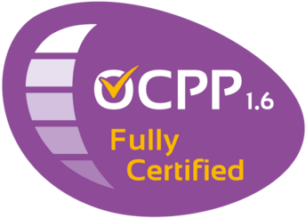

# ioBroker.ocpp

**Tests:** 

## Haftungsausschluss (Disclaimer)
Die Entwickler dieses Moduls werden in keiner Weise von der Open Charge Alliance oder verbundenen Unternehmen unterstützt und stehen in keiner offiziellen Verbindung zu deren Marken oder Logos.

## OCPP-Adapter für ioBroker
Adapter zur lokalen Einbindung und Steuerung von OCPP 1.6-J kompatiblen Wallboxen und Ladestationen über einen lokalen WebSocket-Server.

## Dokumentation
- 🇺🇸 [Documentation](../en/README.md)
- 🇩🇪 [Dokumentation](../de/README.md)

## Konfiguration
- **Server-Port:** TCP-Port, auf dem der OCPP-WebSocket-Server lauscht (Standard: `9220`). In der Wallbox wird als OCPP-Backend-URL `ws://<iobroker-ip>:9220/<Wallbox-ID>` eingetragen.
- **Führenden Schrägstrich (`/`) aus Wallbox-IDs entfernen (`stripLeadingSlash`):** Für Neuinstallationen oder Node-RED-Kompatibilität aktivieren, damit Geräte-Objekte als `ocpp.0.EVB-P123456` statt `ocpp.0./EVB-P123456` angelegt werden. Bei Bestandsinstallationen deaktiviert lassen, um bestehende Objekt-IDs beizubehalten.
- **Authentifizierung:** Optionale HTTP Basic-Authentifizierung (`username` und `password`) beim WebSocket-Verbindungsaufbau.

## Änderungsprotokoll (Changelog)
<!--
	Placeholder for the next version (at the beginning of the line):
	### **WORK IN PROGRESS**
-->
### **WORK IN PROGRESS**
* (meistermopper) Veraltetes `@ampeco/ocpp-eliftech` durch nativen TypeScript OCPP 1.6J Server ersetzt
* (meistermopper) Fehler behoben, durch den SmartCharging bei `GetConfigurationMaxKeys` gelöscht wurde (#65)
* (meistermopper) `TxProfile` für `RemoteStartTransaction` genutzt und `transactionId` verwaltet (#24, #65)
* (meistermopper) Zombie-Sockets bei Reconnect verhindert (#20) und ausgehende OCPP-Kommandos serialisiert
* (meistermopper) Unterstützung für `DiagnosticsStatusNotification` und `FirmwareStatusNotification` (#32)
* (meistermopper) Option `stripLeadingSlash` sowie responsive `jsonConfig` mit i18n ergänzt (#30, #60)

### 0.12.5 (2023-02-09)
* (foxriver76) Änderungen aus 0.12.4 zurückgenommen

### 0.12.3 (2023-02-07)
* (foxriver76) Deaktivieren von `numberPhases` durch Setzen auf `null` ermöglicht

### 0.12.2 (2023-01-19)
* (foxriver76) Sicherstellen, dass der Haupt-Connector (`0`) immer erstellt wird

### 0.12.1 (2023-01-19)
* (foxriver76) Erkennung von Feature-Profilen auch bei unerlaubten Leerzeichen

### 0.12.0 (2023-01-18)
* (foxriver76) `idTag` für Remote-Transaktionen ist nun durchgehend `ioBroker`
* (foxriver76) Verwaltung der lokalen Authentifizierungsliste implementiert
* (foxriver76) Datenpunkte nur erstellen, wenn vom Profil unterstützt (schließt #22)
* (foxriver76) Erhöhte Stabilität bei der ersten Verbindung

[Ältere Einträge befinden sich in der CHANGELOG_OLD.md](../../CHANGELOG_OLD.md)

## Lizenz
MIT License

Copyright (c) 2022-2026 Moritz Heusinger <moritz.heusinger@gmail.com>

Permission is hereby granted, free of charge, to any person obtaining a copy
of this software and associated documentation files (the "Software"), to deal
in the Software without restriction, including without limitation the rights
to use, copy, modify, merge, publish, distribute, sublicense, and/or sell
copies of the Software, and to permit persons to whom the Software is
furnished to do so, subject to the following conditions:

The above copyright notice and this permission notice shall be included in all
copies or substantial portions of the Software.

THE SOFTWARE IS PROVIDED "AS IS", WITHOUT WARRANTY OF ANY KIND, EXPRESS OR
IMPLIED, INCLUDING BUT NOT LIMITED TO THE WARRANTIES OF MERCHANTABILITY,
FITNESS FOR A PARTICULAR PURPOSE AND NONINFRINGEMENT. IN NO EVENT SHALL THE
AUTHORS OR COPYRIGHT HOLDERS BE LIABLE FOR ANY CLAIM, DAMAGES OR OTHER
LIABILITY, WHETHER IN AN ACTION OF CONTRACT, TORT OR OTHERWISE, ARISING FROM,
OUT OF OR IN CONNECTION WITH THE SOFTWARE OR THE USE OR OTHER DEALINGS IN THE
SOFTWARE.

