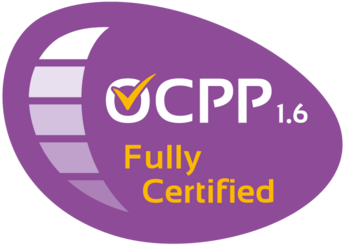

# ioBroker.ocpp

**Tests:** 

## Disclaimer
The developers of this module are in no way endorsed by or affiliated with Open Charge Alliance,
or any associated subsidiaries, logos or trademarks.

## OCPP adapter for ioBroker
Adapter to connect and control OCPP 1.6-J compatible wallboxes and EV charging stations via a local WebSocket server.

## Documentation
- 🇺🇸 [Documentation](../en/README.md)
- 🇩🇪 [Dokumentation](../de/README.md)

## Configuration
- **Server port:** TCP port the OCPP WebSocket server listens on (default: `9220`). Configure your wallbox to connect to `ws://<iobroker-ip>:9220/<ChargePointId>`.
- **Remove leading slash (`/`) from Charge Point IDs (`stripLeadingSlash`):** Enable for new installations or Node-RED compatibility so device objects are created as `ocpp.0.EVB-P123456` instead of `ocpp.0./EVB-P123456` (or `ocpp.0.http://192_168_178_80:9220/EVB-P123456` for wallboxes sending an absolute URL during the WebSocket handshake). Leave disabled to preserve existing object IDs.
- **Authentication:** Optional HTTP Basic Authentication (`username` and `password`) required during the WebSocket handshake.

## Changelog
<!--
	Placeholder for the next version (at the beginning of the line):
	### **WORK IN PROGRESS**
-->
### **WORK IN PROGRESS**
* (meistermopper) replace legacy `@ampeco/ocpp-eliftech` with native TypeScript OCPP 1.6J server
* (meistermopper) fix SmartCharging removal when `GetConfigurationMaxKeys` truncates response (#65)
* (meistermopper) use `TxProfile` for `RemoteStartTransaction` and track `transactionId` (#24, #65)
* (meistermopper) prevent zombie sockets on reconnect (#20) and serialize outgoing OCPP commands
* (meistermopper) support `DiagnosticsStatusNotification` and `FirmwareStatusNotification` (#32)
* (meistermopper) add `stripLeadingSlash` option and responsive `jsonConfig` with i18n (#30, #60)

### 0.12.5 (2023-02-09)
* (foxriver76) revert changes of 0.12.4

### 0.12.3 (2023-02-07)
* (foxriver76) allow deactivating `numberPhases` by setting `null

### 0.12.2 (2023-01-19)
* (foxriver76) ensure main connector is always created even if no status received there

### 0.12.1 (2023-01-19)
* (foxriver76) we now also detect feature profiles if clients add unallowed whitespaces

### 0.12.0 (2023-01-18)
* (foxriver76) the `idTag` for remote transactions is now `ioBroker` persistent over all transactions
* (foxriver76) implemented the management of authentication list
* (foxriver76) only create states if supported by profile (closes #22)
* (foxriver76) increased stability on first connection

[Older changelog entries can be found in CHANGELOG_OLD.md](../../CHANGELOG_OLD.md)

## License
MIT License

Copyright (c) 2022-2026 Moritz Heusinger <moritz.heusinger@gmail.com>

Permission is hereby granted, free of charge, to any person obtaining a copy
of this software and associated documentation files (the "Software"), to deal
in the Software without restriction, including without limitation the rights
to use, copy, modify, merge, publish, distribute, sublicense, and/or sell
copies of the Software, and to permit persons to whom the Software is
furnished to do so, subject to the following conditions:

The above copyright notice and this permission notice shall be included in all
copies or substantial portions of the Software.

THE SOFTWARE IS PROVIDED "AS IS", WITHOUT WARRANTY OF ANY KIND, EXPRESS OR
IMPLIED, INCLUDING BUT NOT LIMITED TO THE WARRANTIES OF MERCHANTABILITY,
FITNESS FOR A PARTICULAR PURPOSE AND NONINFRINGEMENT. IN NO EVENT SHALL THE
AUTHORS OR COPYRIGHT HOLDERS BE LIABLE FOR ANY CLAIM, DAMAGES OR OTHER
LIABILITY, WHETHER IN AN ACTION OF CONTRACT, TORT OR OTHERWISE, ARISING FROM,
OUT OF OR IN CONNECTION WITH THE SOFTWARE OR THE USE OR OTHER DEALINGS IN THE
SOFTWARE.
